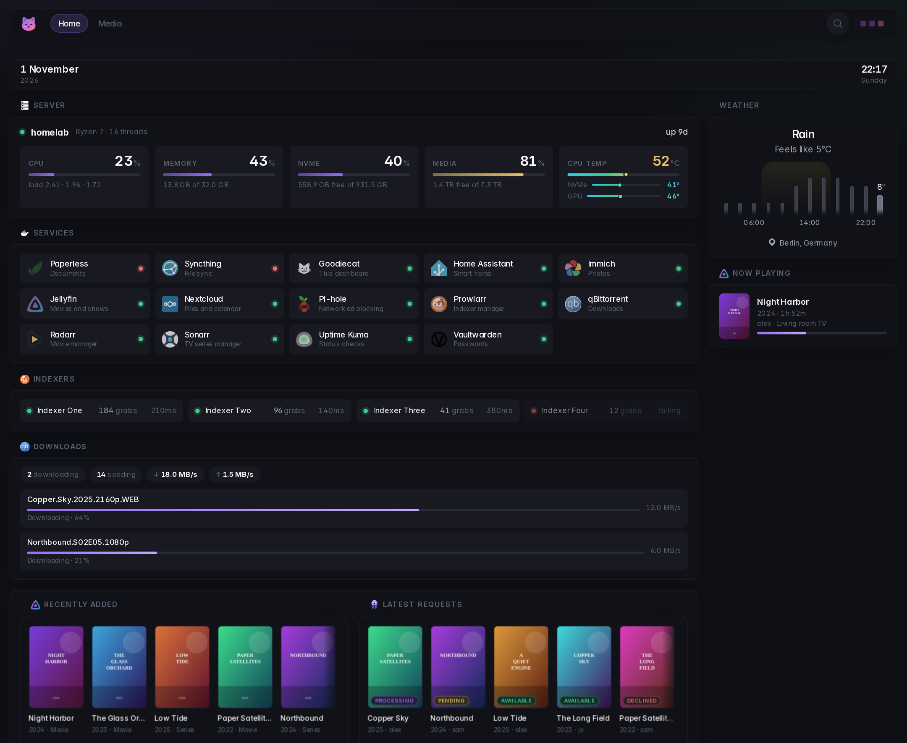
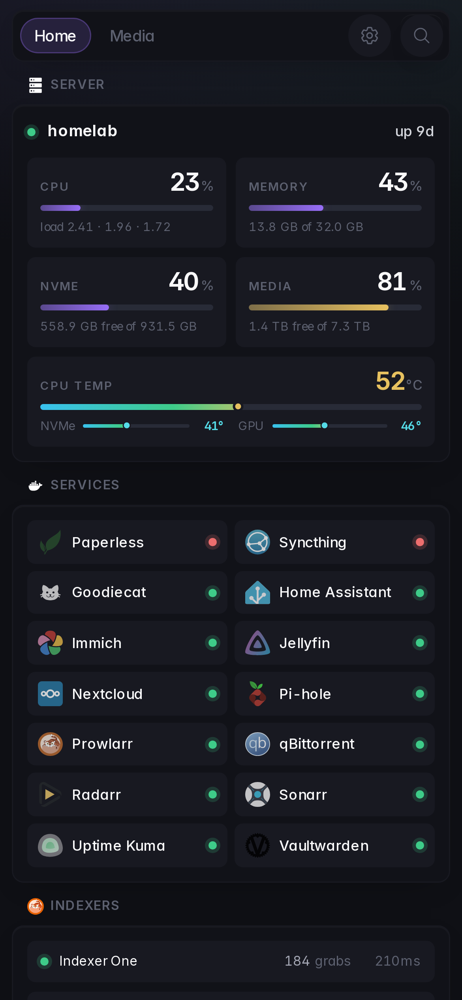
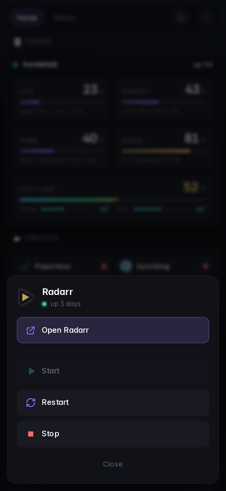
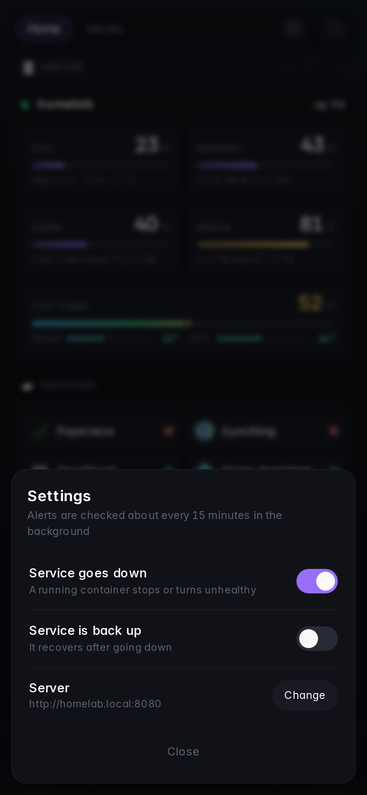
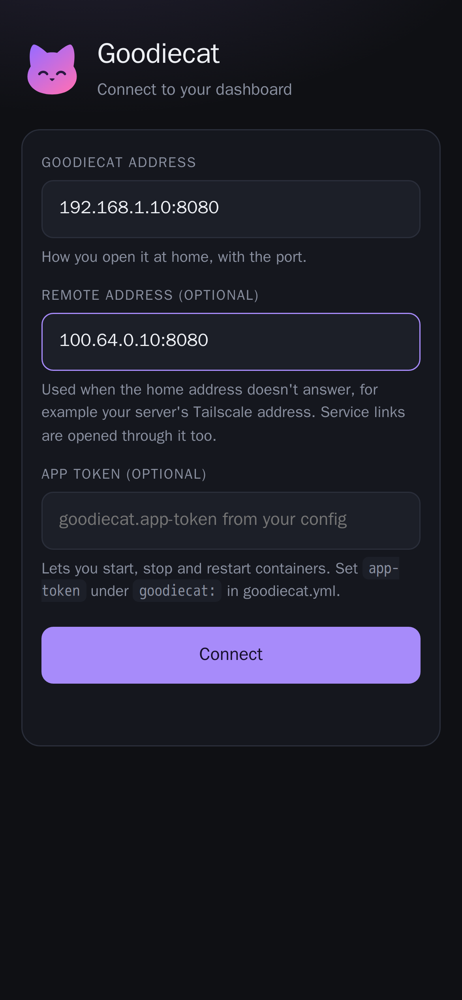
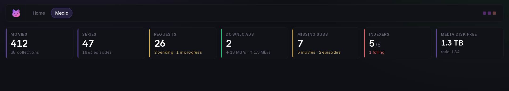
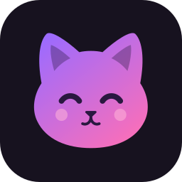

<p align="center"></p>
<h1 align="center">Goodiecat</h1>

<p align="center">A sleek, compact self-hosted dashboard for your home server, with a companion Android app.<br>
A fork of <a href="https://github.com/Panonim/dynacat">Dynacat</a>, which is built on <a href="https://github.com/glanceapp/glance">Glance</a>.</p>

<p align="center">
  <a href="#quick-start">Quick start</a> •
  <a href="#the-android-app">Android app</a> •
  <a href="https://dynacat.artur.zone/configuration">Widget reference</a> •
  <a href="#credits-and-license">Credits</a>
</p>

<p align="center"></p>

<p align="center">
  
  
  
  
</p>
<p align="center"><sub>Demo data. Phone, left to right: the home page, tapping a service in the app, alert settings, first-run setup.</sub></p>

## What's different from Dynacat

Everything Dynacat does still works the same way, with the same YAML and the same widgets. On top of that:

* **A new default look.** Inter font, a cool slate and violet palette, compact cards, colored meters, and service tiles with a green or red status dot.
* **Phones done properly.** Dynacat shows one column at a time on phones and tablets; Goodiecat shows everything, stacked, with the page tabs at the top. Search collapses into an icon.
* **A server card.** CPU, memory, disks and CPU temperature as colored meters, from Goodiecat's own API. It's in the [example config](examples/goodiecat.yml).
* **KPI tiles** for the numbers you care about, as on this media page:

  
* **Building blocks for your own widgets.** `gc-meters`, `gc-kpis`, `gc-rail`, `gc-list`, `gc-chip`, `gc-pill` and more, for `custom-api` templates. They're styled in [goodiecat.css](internal/dynacat/static/css/goodiecat.css).
* **An Android app** with alerts when a container goes down, and start / stop / restart from the dashboard.

Coming from Dynacat? Point Goodiecat at your existing config folder: `dynacat.yml` is picked up as is (or rename it to `goodiecat.yml`).

## Quick start

With Docker:

```bash
git clone https://github.com/Goodborn/goodiecat.git
cd goodiecat/examples
mkdir -p config && cp goodiecat.yml config/
echo "GOODIECAT_APP_TOKEN=$(openssl rand -hex 24)" > .env
docker compose up -d
```

Then open `http://<your-server>:8080`. Edit `config/goodiecat.yml` (the parts marked `CHANGE`), and the dashboard reloads by itself.

The compose file uses `ghcr.io/goodborn/goodiecat:latest`. To build the image yourself instead, run `docker build -t goodiecat .` in the repo root and use `image: goodiecat` in the compose file.

The full widget reference is Dynacat's: [dynacat.artur.zone/configuration](https://dynacat.artur.zone/configuration).

## The `goodiecat:` config section

```yaml
goodiecat:
  # needed for start / stop / restart from the app; any long random string
  app-token: ${GOODIECAT_APP_TOKEN}
  docker:
    sock-path: /var/run/docker.sock   # or tcp://your-docker-socket-proxy:2375
    restart-only: [traefik]           # can be restarted from the app, never stopped
  host:                               # disks shown on the server card
    hide-mountpoints-by-default: true
    mountpoints:
      "/host": { name: System, hide: false }
```

It adds three endpoints:

| Endpoint | What it's for |
| --- | --- |
| `GET /api/goodiecat/host` | CPU, memory, disks and temperature for the server card |
| `GET /api/goodiecat/containers` | Container names, states and health (the app's alerts) |
| `POST /api/goodiecat/containers/{start,stop,restart}` | Container control; needs the `X-Goodiecat-Token` header |

The read-only endpoints follow the dashboard's own login if you've set one up, or accept the token. Control always needs the token. Goodiecat's own container can only be restarted, never stopped.

## The Android app



Get **Goodiecat.apk** from the [latest release](https://github.com/Goodborn/goodiecat/releases/latest). Android 8 or newer.

* **Setup:** enter your dashboard's address (for example `192.168.1.10:8080`). You can add a remote address too, such as the server's Tailscale address; the app uses it whenever home doesn't answer. You can also add the app token.
* **Tap a service** to open its page inside the app, or to start, stop or restart it.
* **Alerts** when a running container stops or turns unhealthy, optionally also when it's back up. You can switch them on and off from the gear icon next to search. The app checks about every 15 minutes in the background, using Android's battery-friendly job scheduler. With both alerts off, nothing runs at all.
* **Service links work away from home too:** links to your server's home address are opened through the remote address, as long as it's the same machine on the same ports (like Tailscale).

To build it yourself, run `./gradlew assembleRelease` in [`android/`](android). Without a `keystore.properties` it's signed with the debug key.

## Credits and license

Goodiecat is a fork of [Dynacat](https://github.com/Panonim/dynacat) by Panonim, which is a fork of [Glance](https://github.com/glanceapp/glance) by svilenmarkov and contributors. Nearly everything here is their work, and all the credit for it goes to them.

Like both of them, Goodiecat is licensed under the [GNU AGPL v3](LICENSE). The bundled [Inter](https://rsms.me/inter/) font is under the [SIL Open Font License 1.1](internal/dynacat/static/fonts/Inter-LICENSE.txt).
