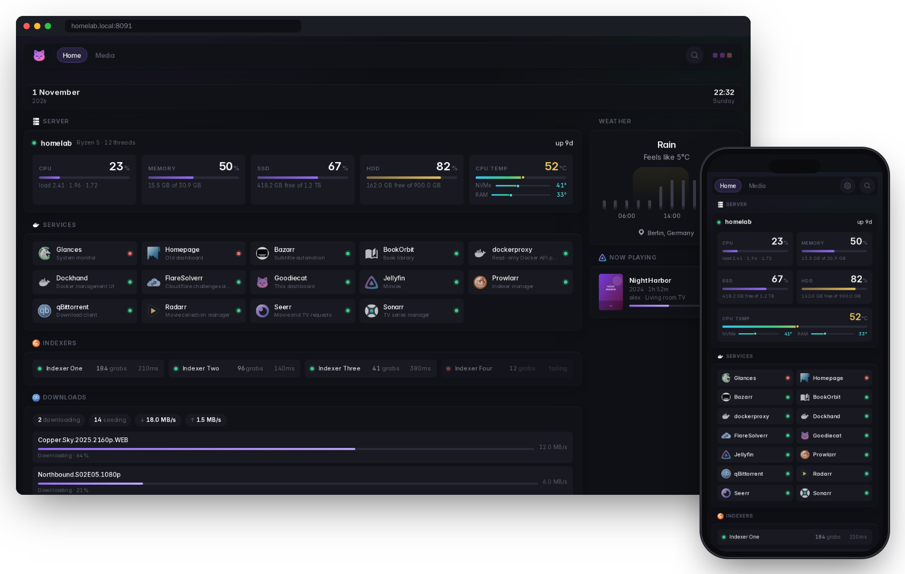

<p align="center"></p>
<h1 align="center">Goodiecat</h1>
<p align="center">Your home server at a glance, on your computer and your phone.</p>
<p align="center">
  <a href="https://github.com/Goodborn/goodiecat/releases/latest"></a>
  <a href="https://github.com/Goodborn/goodiecat/releases/latest/download/Goodiecat.apk"></a>
  <a href="LICENSE"></a>
</p>

<p align="center"></p>

<table align="center"><tr>
<td align="center">🖥️<br><b>Server health</b><br><sub>CPU, memory, disks, temperature</sub></td>
<td align="center">🟢<br><b>Your apps</b><br><sub>green = running, red = down</sub></td>
<td align="center">📱<br><b>Phone app</b><br><sub>open, start, stop, restart</sub></td>
<td align="center">🔔<br><b>Alerts</b><br><sub>when something goes down</sub></td>
</tr></table>

## Get started

**1. Install** on the computer that runs your apps (Linux). Copy this into its terminal:

```bash
curl -fsSL https://raw.githubusercontent.com/Goodborn/goodiecat/main/install.sh | sh
```

It installs Docker if you don't have it, asks for your city (for the weather), and starts Goodiecat.

**2. Open** the address it shows you, like `http://192.168.1.10:8080`, in any browser.

**3. Get the app:** download [**Goodiecat.apk**](https://github.com/Goodborn/goodiecat/releases/latest/download/Goodiecat.apk) on your Android phone and type in the address and app token the installer showed you.

<p align="center"></p>

## Good to know

- **Update:** run the install command again. Your settings are kept.
- **Change things:** edit `~/goodiecat/config/goodiecat.yml`. The dashboard updates as soon as you save.
- **Everything else** (away from home, alerts, adding widgets): **[the guide](docs/goodiecat.md)**.

<sub>Goodiecat is a fork of <a href="https://github.com/Panonim/dynacat">Dynacat</a>, which is built on <a href="https://github.com/glanceapp/glance">Glance</a>. All credit for the base goes to them. AGPL-3.0. Screenshots use demo data.</sub>
