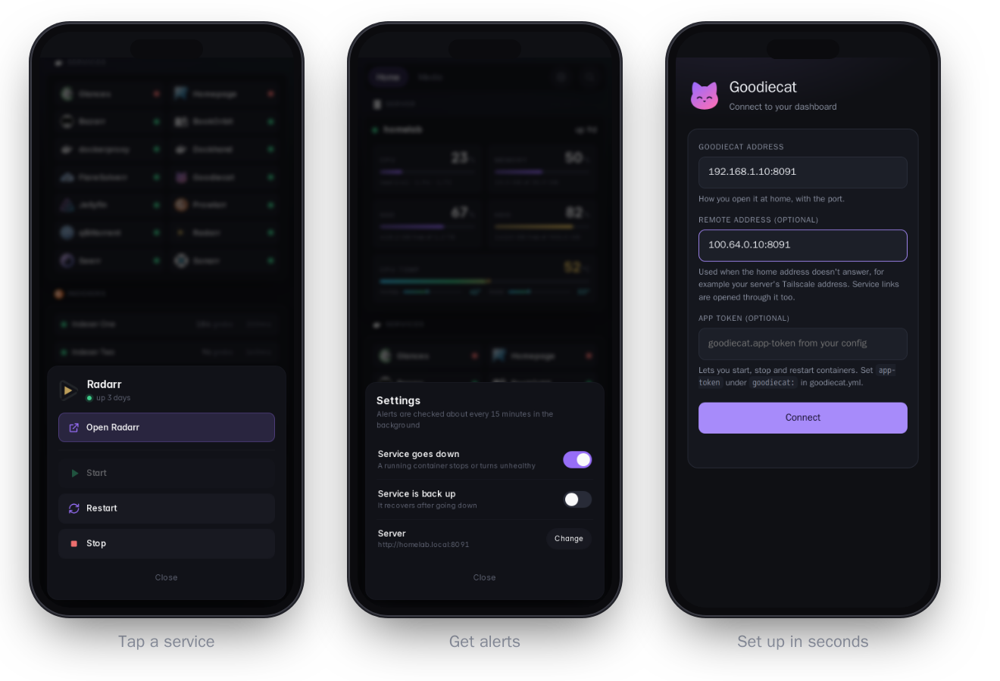

# The Goodiecat guide

1. [Install](#1-install)
2. [Your dashboard](#2-your-dashboard)
3. [The phone app](#3-the-phone-app)
4. [Update or remove](#4-update-or-remove)
5. [Coming from Dynacat](#5-coming-from-dynacat)
6. [Reference](#6-reference)

---

## 1. Install

Run this on the computer that runs your apps (any Linux machine: a home server, a NAS, a Raspberry Pi):

```bash
curl -fsSL https://raw.githubusercontent.com/Goodborn/goodiecat/main/install.sh | sh
```

The installer:

1. installs Docker if it's missing (it asks first),
2. creates a `goodiecat` folder in your home folder,
3. picks a free port (8080 unless it's taken) and makes a random **app token** for the phone app,
4. asks for your city, for the weather (you can skip it),
5. starts Goodiecat and shows you the address and the app token.

> **Lost the app token?** It's in `~/goodiecat/.env`, on the line `GOODIECAT_APP_TOKEN=`.

<details>
<summary>Install by hand instead</summary>

```bash
mkdir -p ~/goodiecat/config && cd ~/goodiecat
curl -fsSLo docker-compose.yml https://raw.githubusercontent.com/Goodborn/goodiecat/main/examples/docker-compose.yml
curl -fsSLo config/goodiecat.yml https://raw.githubusercontent.com/Goodborn/goodiecat/main/examples/goodiecat.yml
printf 'GOODIECAT_APP_TOKEN=%s\nGOODIECAT_PORT=8080\n' "$(openssl rand -hex 24)" > .env
docker compose up -d
```

</details>

---

## 2. Your dashboard

Out of the box you get:

| | |
| --- | --- |
| **Server** | CPU, memory, your main drive and the CPU temperature. Bars turn amber, then red, as they fill up. |
| **Services** | Every Docker container on the computer. A **green dot** means it's running; a **red dot** means it's stopped or unhealthy. |
| **Weather and calendar** | On the right, or below on a phone. |
| **Services tab** | Every container's CPU and memory use, busiest first. Home stays clean; the detail is one tap away. |

Your settings live in **`~/goodiecat/config/goodiecat.yml`**. Save the file and the dashboard updates by itself; no restart needed.

### Give a service a nice name, an icon and a link

Find the `docker-containers` widget in the file and add your container under `containers:`, using the container's name:

```yaml
            containers:
              jellyfin:
                name: Jellyfin
                description: Movies and shows
                url: http://192.168.1.10:8096
                icon: sh:jellyfin
```

Icons: `sh:` + a name from [selfh.st/icons](https://selfh.st/icons), or `mdi:` + a name from [Material Design Icons](https://pictogrammers.com/library/mdi/).

### Show a second drive on the server card

1. Mount it into Goodiecat in `docker-compose.yml`, under `volumes:` (for example `- /mnt/media:/mnt/media:ro`).
2. Add it under `goodiecat:` → `host:` → `mountpoints:` in `goodiecat.yml`:

```yaml
      "/mnt/media":
        name: Media
        hide: false
```

3. Run `docker compose up -d` in `~/goodiecat`.

### Add more widgets

Goodiecat has every widget Dynacat has: RSS, bookmarks, calendars, Jellyfin, Pi-hole, market prices and more. See the **[widget list](https://dynacat.artur.zone/configuration)**.

---

## 3. The phone app

<p align="center"></p>

**Install:** download [**Goodiecat.apk**](https://github.com/Goodborn/goodiecat/releases/latest/download/Goodiecat.apk) on the phone and open it. Android may ask you to allow installing apps from your browser. Android 8 or newer.

**Set up:**

| Field | What to type |
| --- | --- |
| Goodiecat address | The address from the installer, like `192.168.1.10:8080` |
| Remote address *(optional)* | How to reach the same computer when you're away, like its Tailscale address `100.x.y.z:8080` |
| App token *(optional)* | The token from the installer. Without it you can look, but not start or stop. |

You can change these later from the ⚙️ gear icon → **Server** → **Change**.

**Tap any service** to get:

- **Open**: the service's page, inside the app
- **In browser**: the same page in your phone's browser. Logins (like qBittorrent's) work best there.
- **Start / Restart / Stop**: Stop asks you to tap twice. Goodiecat itself can only be restarted, never stopped.

**Alerts:** the app checks your containers about every 15 minutes and tells you when one goes down. You can also turn on "back up" alerts. Both are behind the ⚙️ gear icon. It uses Android's battery-friendly background jobs, and if you switch both alerts off, nothing runs at all.

**Away from home:** the app uses the remote address whenever the home address doesn't answer. Links to your services are switched to the remote address too. With Tailscale's "only some apps" setting, add Goodiecat to that list, and your browser too if you use **In browser**.

---

## 4. Update or remove

**Update:** run the install command again. It downloads the latest Goodiecat and keeps your settings, port and token.

**Remove:**

```bash
cd ~/goodiecat && docker compose down && cd ~ && rm -rf ~/goodiecat
```

---

## 5. Coming from Dynacat

Goodiecat reads your Dynacat config as is: point it at your existing config folder and it picks up `dynacat.yml`, or rename the file to `goodiecat.yml`. The new look is built in, so you can drop a custom CSS file you only used for styling.

---

## 6. Reference

### The `goodiecat:` settings

```yaml
goodiecat:
  app-token: ${GOODIECAT_APP_TOKEN}   # unlocks start / stop / restart from the app
  docker:
    sock-path: /var/run/docker.sock   # or tcp://your-docker-socket-proxy:2375
    restart-only: [traefik]           # restart-only; Goodiecat itself always is
  host:                               # drives on the server card
    hide-mountpoints-by-default: true
    mountpoints:
      "/host": { name: System, hide: false }
```

### API

| Endpoint | Returns / does |
| --- | --- |
| `GET /api/goodiecat/host` | CPU, memory, drives, temperature, uptime |
| `GET /api/goodiecat/containers` | Each container's name, state and health |
| `GET /api/goodiecat/containers/stats` | CPU (share of the whole machine) and memory per container, refreshed in the background |
| `POST /api/goodiecat/containers/{start,stop,restart}` | Controls a container. Body `{"name": "…"}`; needs the `X-Goodiecat-Token` header |

The read endpoints use the dashboard's own login if you've set one up, otherwise they're open like the dashboard itself. Control always needs the token.

### Styling your own widgets

For `custom-api` templates, Goodiecat includes ready-made pieces:

| Class | Looks like |
| --- | --- |
| `gc-meters` + `gc-meter` | the server card's tiles with bars |
| `gc-kpis` + `gc-kpi` | big-number tiles |
| `gc-rail` + `gc-poster-card` | a scrolling row of posters |
| `gc-list` + `gc-list-row` | compact rows |
| `gc-svc` + `gc-svc-row` | the Services tab's rows with CPU and RAM bars |
| `gc-chip`, `gc-pill`, `gc-dot-ok` / `gc-dot-bad` | small labels and status dots |

They're defined in [goodiecat.css](../internal/dynacat/static/css/goodiecat.css). The [example config](../examples/goodiecat.yml) shows the server card built from them.

### Build it yourself

- **Docker image:** `docker build -t goodiecat .` in the repo root.
- **Android app:** `./gradlew assembleRelease` in [`android/`](../android). It's signed with the debug key unless you add a `keystore.properties`.

### Credits and license

Goodiecat is a fork of [Dynacat](https://github.com/Panonim/dynacat) by Panonim, which is a fork of [Glance](https://github.com/glanceapp/glance) by Svilen Markov and contributors. Nearly all of the code is theirs.

License: [GNU AGPL v3](../LICENSE). The bundled [Inter](https://rsms.me/inter/) font is under the [SIL Open Font License 1.1](../internal/dynacat/static/fonts/Inter-LICENSE.txt).
